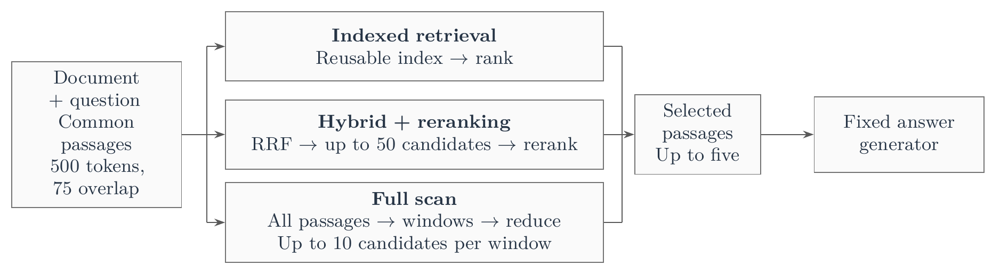
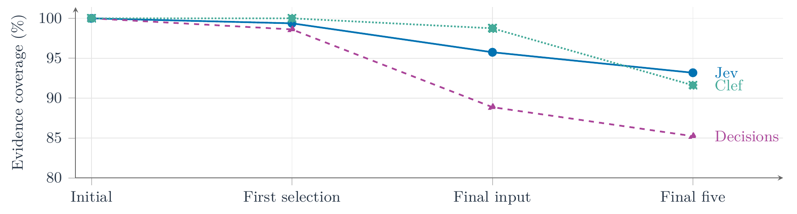
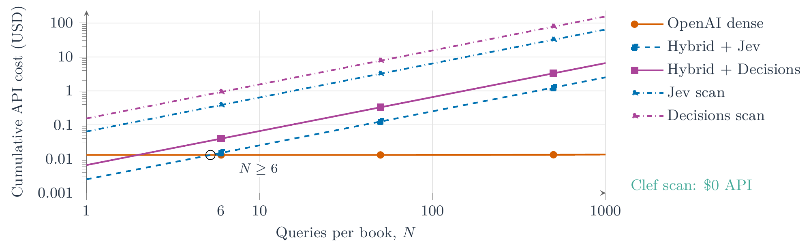
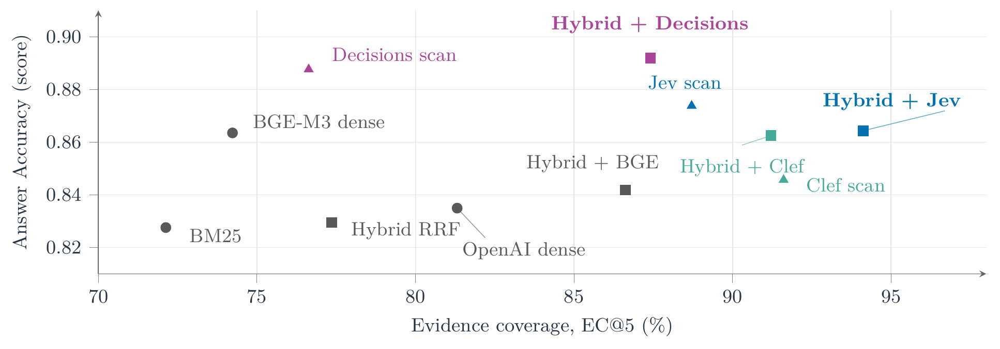

# Scan or Index?

**Evidence Coverage, Answer Quality, and Cost in Long-Document RAG**

Experimental code and measured results accompanying *Scan or Index?*. The study compares 11 retrieval configurations spanning lexical and dense search, hybrid reranking, and full-document scanning with Jev, OpenAI Decisions, and local Cloudflare Clef.

[Experiment guide](research/README.md) · [Numerical results](results/README.md) · [Chart data and scope](results/figures/README.md) · [Annotation application](annotation/README.md)

## Experimental design



All methods use common passages of approximately 500 tokens with 75-token overlap and return up to five passages. Hybrid rerankers receive the same pool of up to 50 candidates; full scans consider every passage before hierarchical reduction. Generation packs complete, deduplicated contributions within the same 2,500-token context budget.

| Dataset | Evaluation questions | Reference provenance |
| --- | --- | --- |
| QASPER | 320 answerable + 76 unanswerable questions from 264 articles | Human references |
| Textbooks | 80 questions across eight complete OpenStax books | 78 model-authored and two human-authored questions |

Development uses separate documents. Textbook references have no independent human validation. The fixed answer sample contains 100 answerable and 40 unanswerable QASPER questions, plus 60 textbook questions. Two answer controls use reference evidence or no evidence. Answers use `gpt-4.1-mini-2025-04-14`; RAGAS 0.4.3 uses `gpt-6.1-sol` with medium reasoning.

## Results

### Evidence coverage

**EC@5** is annotated source-text evidence covered by the five retrieved passages, averaged within documents and then across documents.

| Method | QASPER EC@5 | Textbook EC@5 |
| --- | ---: | ---: |
| BM25 | 84.7% | 72.1% |
| OpenAI dense | 90.4% | 81.3% |
| BGE-M3 dense | 89.9% | 74.2% |
| Hybrid RRF | 88.5% | 77.4% |
| Hybrid + BGE | 88.9% | 86.6% |
| Hybrid + Jev | 97.0% | 94.1% |
| Hybrid + Decisions | 96.2% | 87.4% |
| Hybrid + Clef | 98.8% | 91.2% |
| Jev full scan | 97.7% | 88.7% |
| Decisions full scan | 96.2% | 76.6% |
| Clef full scan | 98.8% | 91.6% |

QASPER coverage uses the 320 answerable questions; textbook coverage uses all 80 assignments. Failed retrievals contribute zero recovered evidence. Pointwise 95% document-bootstrap intervals are available in [retrieval.csv](results/retrieval.csv).

Hybrid + Jev has the highest observed textbook coverage, **94.1%**. Most QASPER articles fit within the hybrid pool: 395 of 396 questions receive the whole document in that pool, and both Clef variants return identical rankings on all 396 cases.

### Where full scanning loses evidence



Each curve uses that method's completed textbook scans: **Jev 76, Decisions 72, Clef 80**. These are different successful subsets. Initial coverage is 100%, but final-five coverage is 93.18%, 85.23%, and 91.61%, respectively. These traces are conditional on completion; the coverage table also includes failed assignments.

### Retrieval latency

| Method | QASPER median / p95 (s) | Completed | Textbook median / p95 (s) | Completed |
| --- | ---: | ---: | ---: | ---: |
| Hybrid + Jev | 0.338 / 0.751 | 396/396 | 1.724 / 2.372 | 79/80 |
| Hybrid + Decisions | 0.621 / 1.163 | 395/396 | 4.514 / 5.577 | 80/80 |
| Hybrid + Clef | 5.453 / 10.133 | 396/396 | 54.691 / 62.580 | 80/80 |
| Jev full scan | 0.339 / 0.717 | 396/396 | 25.103 / 45.711 | 76/80 |
| Decisions full scan | 0.621 / 1.038 | 396/396 | 63.361 / 112.586 | 72/80 |
| Clef full scan | 5.462 / 10.109 | 396/396 | 1397.672 / 2494.531 | 80/80 |

These are **first-execution phase latencies**, with failures excluded. Hybrid measurements cover reranking only, excluding candidate generation; full scans include selection and reduction. Jev and Decisions allow two concurrent API calls. Clef runs one BF16 inference request at a time on a shared GB10 GPU. Dates, hardware, concurrency, and service conditions differ, so these are descriptive deployment measurements rather than controlled model-speed comparisons. Clef full scanning has a textbook median of **23.3 minutes**.

### API cost as documents are reused



Projected retrieval API cost follows **C(N) = P + N × Q**, using measured preparation and per-query costs. Both graph axes are logarithmic. Broken lines are known-charge lower bounds. The dense/Hybrid + Jev projection crosses at approximately **5.21 queries**, so dense is cheaper by query six; unknown charges can move the actual crossover earlier.

| Method | QASPER: USD per 1,000 queries | Textbook: USD per 1,000 queries |
| --- | ---: | ---: |
| OpenAI dense | 0.000296 | 0.01351 |
| Hybrid + Jev | 0.30214 | ≥ 2.52 |
| Hybrid + Decisions | ≥ 0.69345 | 6.63 |
| Jev full scan | 0.30537 | ≥ 64.43 |
| Decisions full scan | 0.70142 | ≥ 155.85 |
| Clef (both variants) | 0 | 0 |

Costs are in USD at the recorded execution rates. **≥** denotes a lower bound, rounded down, because some consumption is unknown. Query costs include known charges from failed base attempts and are averaged within documents and then across documents. Generation, judging, timing repetitions, and local resources are excluded. Clef has zero retrieval API charges; its computing resources are unpriced.

### Does more evidence lead to better answers?



Hybrid + Jev has higher textbook EC@5 (**94.1%**) but Answer Accuracy of **0.864**. Hybrid + Decisions has lower EC@5 (**87.4%**) and the highest observed Answer Accuracy among retrievers (**0.892**). More annotated evidence therefore does not consistently coincide with higher automatic answer scores.

| Method | QASPER AA | Textbook AA | Textbook FA |
| --- | ---: | ---: | ---: |
| BM25 | 0.581 [100/100] | 0.828 [60/60] | 0.891 [59/59] |
| OpenAI dense | 0.614 [99/100] | 0.835 [60/60] | 0.910 [60/60] |
| BGE-M3 dense | 0.623 [100/100] | 0.864 [60/60] | 0.901 [60/60] |
| Hybrid RRF | 0.592 [100/100] | 0.829 [60/60] | 0.938 [59/59] |
| Hybrid + BGE | 0.608 [100/100] | 0.842 [59/59] | 0.947 [59/59] |
| Hybrid + Jev | 0.607 [99/99] | 0.864 [60/60] | 0.963 [60/60] |
| Hybrid + Decisions | 0.609 [99/99] | 0.892 [60/60] | 0.974 [60/60] |
| Hybrid + Clef | 0.613 [100/100] | 0.862 [59/60] | 0.962 [59/60] |
| Jev full scan | 0.602 [100/100] | 0.874 [57/57] | 0.975 [57/57] |
| Decisions full scan | 0.615 [100/100] | 0.888 [53/53] | 0.973 [53/53] |
| Clef full scan | 0.633 [100/100] | 0.846 [60/60] | 0.963 [59/60] |
| Reference context (control) | 0.672 [99/100] | 0.938 [60/60] | 0.906 [60/60] |
| No evidence (control) | 0.052 [100/100] | 0.808 [59/60] | N/A |

**AA**: Answer Accuracy; **FA**: Faithfulness. Brackets are scored/requested evaluations. These are document-macro automated scores, not percentages of human-verified correctness. Missing answers and failed evaluations are excluded; Faithfulness also requires supplied evidence and a non-abstaining answer.

The no-evidence control permits prior knowledge and scores **0.808** on textbooks, so a high automatic score alone does not establish dependence on retrieved evidence.

The scatter compares EC@5 over 80 textbook retrieval assignments with Answer Accuracy over 53–60 successfully scored responses from 60 generation assignments. It is descriptive, not a paired question-level or causal comparison. Paired comparisons and their existing uncertainty are retained in the [numerical results](results/README.md).

## Methods

| Method | Retrieval strategy |
| --- | --- |
| BM25 | Lexical ranking |
| OpenAI dense | `text-embedding-3-small`, exact cosine search |
| BGE-M3 dense | Local dense retrieval |
| Hybrid RRF | BM25 and BGE-M3 with reciprocal rank fusion |
| Hybrid + BGE | BGE reranking of the common hybrid candidates |
| Hybrid + Jev / Decisions / Clef | Decision-based reranking of the common hybrid candidates |
| Jev / Decisions / Clef full scan | Windowed search over the complete document and candidate reduction |

The original seven-method experiment and the Decisions and Clef extensions retain separate execution dates and provenance. [Protocol settings](research/config/protocol.json) and [evaluation definitions](research/METRICS-LITERATURE.md) document the measured configuration.

## Installation

Requirements: **Node.js 24+** and **Python 3**. Local BGE and Clef inference requires the corresponding Python environments; the mock experiment and aggregate verification do not require a GPU or API credentials.

```sh
npm ci
npm run check:all
npm run test:all
```

## Run an offline experiment

```sh
npm run research -- --help
npm run research -- mock-demo \
  --id mock-demo \
  --out data/research/mock-demo \
  --budget-file data/research/mock-budget.sqlite
python3 results/verify.py
```

The mock experiment exercises the retrieval and generation pipeline with synthetic data and simulated providers. Its outputs are labeled `mock` and are excluded from measured results. See the [experiment guide](research/README.md) for dataset import, model setup, measured runs, and evaluation.

## Interactive applications

### Retrieval demo

```sh
cp .env.example .env
# Set TYPESAFE_API_KEY and OPENAI_API_KEY in .env.
npm run dev
```

Open **http://127.0.0.1:5174**. The demo supports PDF, DOCX, and TXT import, passage inspection, Jev/dense retrieval comparisons, and per-attempt cost accounting. It runs locally and does not generate answers. The interface is in Spanish.

```sh
npm run build
npm start
```

The compiled demo is served at **http://127.0.0.1:3001**.

### Annotation application

```sh
npm run annotation:admin -- bootstrap 'Coordinator'
npm run dev:annotate
```

Open **http://127.0.0.1:5175**. The separate application supports invitations, question authoring, evidence selection, review, adjudication, dataset versions, and blind answer evaluation. It does not require model-provider credentials. See [annotation setup](annotation/README.md) and [deployment](deploy/annotation/README.md).

## Repository structure

| Directory | Contents |
| --- | --- |
| `research/` | Experiment runners, retrieval adapters, metrics, statistical analysis, and RAGAS integration |
| `results/` | Numerical measurements, chart assets, aggregate audits, and checksum verification |
| `server/`, `src/`, `shared/` | Local retrieval demo and shared document utilities |
| `annotation/` | Standalone annotation server and web interface |
| `deploy/` | Annotation packaging and deployment utilities |
| `tests/` | Demo and extraction tests |

## Data and reproducibility

The repository distributes code and numerical results. Full source documents, question banks, generated answers, provider traces, application databases, and credentials are not distributed. Recomputing measurements from raw inputs requires the matching datasets and frozen run artifacts; verifying the distributed result checksums does not require them.

[Protocol configuration](research/config/protocol.json), [dataset provenance](research/OPENSTAX-ACQUISITION.md), and the [annotation protocol](research/ANNOTATION-PROTOCOL.md) document the recorded experiment. Model revisions, configuration hashes, source hashes, failures, and unresolved API usage are retained in the result provenance. Source-document licenses apply independently to acquired datasets.
